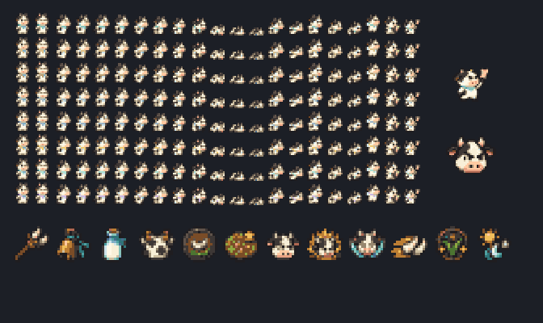
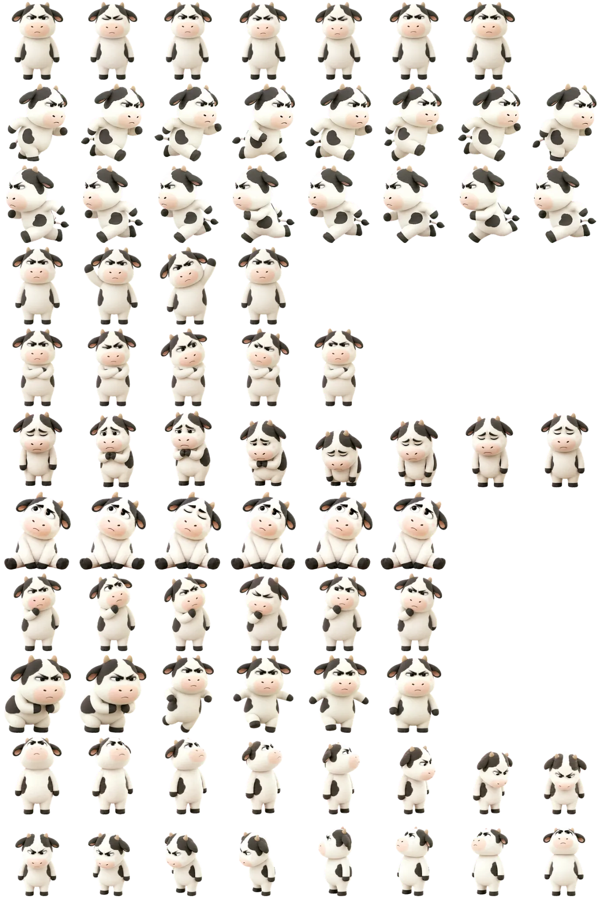
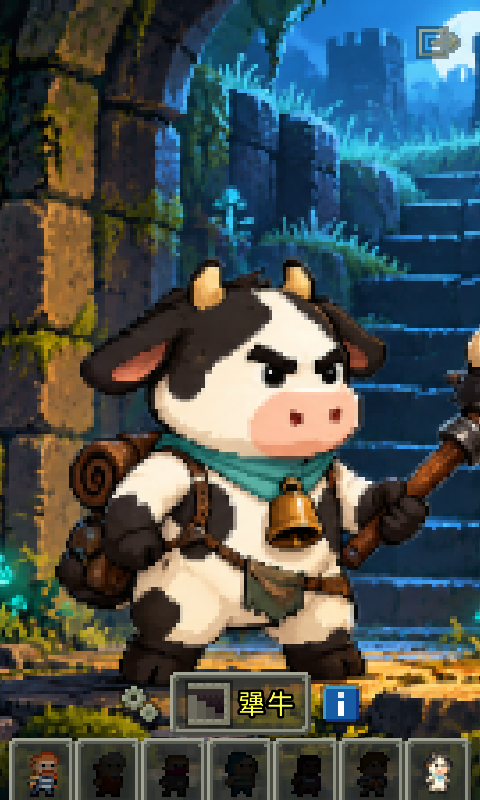

# 🐮 犟牛地牢 · Jiangniu Pixel Dungeon

> 桌面上那个总在皱眉的「牛哞」，带着围兜和一肚子意见进地牢了。基于 [Shattered Pixel Dungeon 4.0.2](https://github.com/00-Evan/shattered-pixel-dungeon) 的中文同人扩展，保留原版六名英雄，新增开局即可选择的第七英雄 **「犟牛」**。

**v1.1.0 已完成本地编译，完整 APK 与源码 ZIP 随本次交付提供。GitHub 完整 APK 上传及源码分支发布：待完成。** [SHA-256 校验](downloads/SHA256SUMS.txt) · [完整玩法说明](docs/jiangniu-guide.md) · [更新日志](docs/jiangniu-release-notes.md) · [验证记录](verification/v1.1.0/README.md)

## 🌱 v1.1.0：有工龄，有脾气，也得认真打地牢

本次将专属武器、围兜、牛铃和终局技能做成可成长体系。**进化提供有限数值成长与有条件的配合效果**：倔劲仍要通过战斗积攒，技能仍消耗回合，护盾和控制持续时间有限。高阶装备、升级卷轴、走位与补给依然重要。

「历练」与战斗资源「倔劲」分开计算。装备进化需要同时满足下表两项条件：

| 阶段 | 条件 | 武器 | 围兜 | 本命神器 |
| --- | --- | --- | --- | --- |
| 初出牛棚 | 开局 | 犟角 | 拼斑围兜 | 不服铃 |
| 熟练工牛 | 12 历练＋英雄 3 级 | 讲理角锤 | 值班围兜 | 申诉小铃 |
| 犟角行家 | 40 历练＋英雄 8 级 | 抬杠扳手 | 不背锅围裙 | 调解牛铃 |
| 老牌犟牛 | 90 历练＋英雄 14 级 | 老班长的犟角 | 老班长的围裙 | 主持公道铃 |

- **犟角：** 一阶起，每第三次有效武器命中获得有限追击，后续进化追加短暂残废、易伤。仍可升级、附魔。
- **围兜：** 受敌方直接伤害时攒下有限「黑锅」，下次普通攻击最多卸下两层；高阶可获得很小的短时护盾，有冷却且不累加。脱下围兜清空黑锅，布甲也不会自动变成板甲。
- **牛铃：** 一阶让移动后的顶撞附加短暂虚弱；二阶鼓励在 6 回合内交替使用顶撞与踏地；三阶解锁耗 4 倔劲的 **「据理力争」**，用低伤害、短程虚弱缓解围攻。
- **终局技能：** 「万蹄奔雷」「方寸牧场」「夜半开工」分别记录有效使用次数，在第 3、7 次后获得两级有限强化。空放不能练级，充能费用保持原有规则。

### 🔔 怎么玩

开局有 **3 点倔劲**，基础上限 **6 点**；普通攻击造成有效伤害或实际承受敌方直接伤害时积攒。顶撞、踏地仍各消耗 **3 点倔劲与 1 回合**。

点击快捷栏牛铃可瞄准顶撞。打开背包中的牛铃，可以使用踏地、查看 **「成长手册」**，或翻阅 **「牛言牛语」**。二阶的两招交替配合只额外提供 2 点伤害或 2 点基础护盾，触发后窗口结束；重复同招、原地等待和空放不能获得配合奖励。长说明和相册支持滚动，操作按钮保持可见。

击败天狗后仍可转为偏进攻的 **「撼地蛮牛」** 或偏守护的 **「守夜牧卫」**；击败矮人王后用皇冠获得 **「星牧战铠」**，保留原护甲的阶级、强化与刻印，同时继承围兜的成长机制。原有 **26 项专属天赋**、补给与职业路线继续保留。

### 🥛 牛言牛语

新增 **18 个每局一次的彩蛋条目**，涉及探索、食物、怪物和技能熟练。牛铃里的相册只显示已经发现的内容，留一点自己撞见的乐趣。绝大多数条目只有对白和收集记录；仅两项提供一次性的 **2 点护盾、3 回合** 小纪念，不能刷成资源来源。原有草丛、镜子和 NPC 彩蛋继续保留。

## 🌟 从 Codex 桌宠「牛哞」到地牢英雄

角色原型是 **Jarvis 创作的 Codex 桌宠「牛哞」**：黑白花纹、短角、粉色鼻头、粗眉毛，以及「我就是不服」的表情。v1.1.0 继续复用已有像素人物、装备图标、动作和插画。

**[▶ 在 Codex Pets 查看、下载原始「牛哞」桌宠](https://codex-pets.net/#/pets/niumou)**（[可分享的作品介绍页](https://codex-pets.net/share/niumou)）

展开查看原始桌宠素材

[查看或保存原始精灵图](docs/art/niumou-original-spritesheet.webp)

## 📱 下载、安装与更新

当前提供本地构建的完整 `Jiangniu-v1.1.0.apk`；**GitHub APK 下载入口与源码分支尚未发布**，发布完成后再补充对应链接。

1. 在 Android 5.0 或更新系统中打开本次交付的 APK 安装。
2. 首次启动默认简体中文，在开局选人界面直接选择第七位英雄「犟牛」。
3. 已安装 v1.0.0 时，新版沿用相同包名与签名，可直接覆盖安装。**最终重建 APK 的真实旧档覆盖升级、再次保存与加载均已通过**；角色、装备、倔劲与护甲能力保留，历练只迁移一次。

包名保持 `com.jarvistowne.jiangniu`，可与原版共存。应用内版本为 `4.0.2-1.1.0`，`versionCode` 为 `1100`。v1、v2 签名验证通过，证书与 v1.0.0 相同；使用固定公开开发签名，属于个人侧载体验版，详见 [签名说明](tools/signing/README.md)。

APK 文件长度为 **35,455,851 字节**，SHA-256 为 `72b9f880c54ffd94c86a8d664ffb1668e660a4e9efb30196d1630f939b9d2f4e`。

## 🧪 验证与源码

本轮恢复后的源码已经重新构建并完成以下验证，结果对应本次交付 APK：

| 验证项 | 本轮结果 |
| --- | --- |
| 核心逻辑 | **57 项全部通过**，0 失败、0 错误、0 跳过 |
| Android 构建 | 游戏 APK、测试 APK、Lint 任务均成功 |
| Android Lint | **0 错误、5 个已有 manifest/API 警告**；离线执行，未检查依赖新版本 |
| 资源与中文 | 7 张纹理、168 个动画格、222 个中文机制文本键、26 项专属天赋检查通过 |
| 包体与签名 | 四种 ABI、16 KiB 页对齐、v1/v2 签名检查通过；证书与 v1.0.0 相同 |
| Android 实际交互 | **通过**；成长菜单、相册触控滚动、新技能命中与资源消耗、成长和彩蛋存档恢复 |
| v1.0.0 覆盖升级与旧档加载 | **通过**；真实旧版存档正常读取、保存后重载，旧计数只迁移一次 |

证据和测试边界见 [本轮验证记录](verification/v1.1.0/README.md)。不将重建前安装包的运行结果计入本次最终 APK。

新版交互测试为 `OK (1 test)`，耗时 **175.453 秒**，留存 13 张流程截图。等级 14、90 历练和相册 18 项满记录由测试注入，用于检查后期功能、滚动界面与存档；不代表自然游玩解锁或完整通关。长期强度仍将根据实际游玩反馈校准。

 

Android 9 实测：进化牛铃菜单与成长手册；后期条件为测试注入。

本版使用 **本地编译与测试**，不运行 GitHub Actions。当前交付完整 APK 与源码 ZIP；GitHub 完整 APK 上传和源码分支发布仍待完成。

- [详细玩法、数值、存档兼容和本地构建](docs/jiangniu-guide.md)
- [版本更新说明](docs/jiangniu-release-notes.md)
- [原始桌宠与像素美术](docs/art/)；[美术制作说明](docs/art/犟牛美术说明.md)
- 构建环境：JDK 17、Android SDK Platform 36、Build Tools 36.0.0，使用仓库内 Gradle wrapper。

## 📄 开源与致谢

本项目基于 **[Shattered Pixel Dungeon](https://github.com/00-Evan/shattered-pixel-dungeon)**（Evan Debenham）和 **[Pixel Dungeon](https://github.com/00-Evan/pixel-dungeon-gradle)**（Watabou），遵守 **[GPL-3.0 许可证](LICENSE.txt)** 并保留原作者版权声明。此为个人同人改作，并非原版 SPD 官方发布。桌宠形象来自作者 Jarvis 提供的「牛哞」素材。
